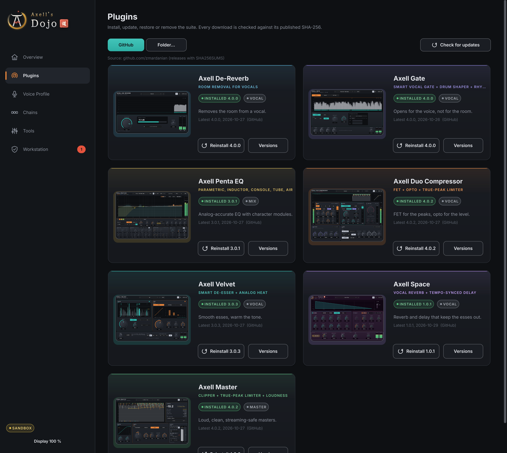

# Axell Signature Dojo

[](https://github.com/zmardanian/axell-signature-dojo/actions/workflows/ci.yml)

**Axell's Dojo** - the home of the Axell Signature suite on Linux: it installs and updates the seven plugins, tunes a
complete vocal chain to *your* voice from one dry take, and sets up REAPER and your workstation.



## The suite (connected through one shared core)

| Plugin | What it is | Latest |
|---|---|---|
| [Axell De-Reverb](https://github.com/zmardanian/axell-dereverb) 4.0.0 | removes the room from a close vocal (a trained network), LIVE mode for recording | **TRUE TONE**: gives back the low end room removal takes too much of |
| [Axell Gate](https://github.com/zmardanian/axell-gate) 4.0.0 | a gate that hears the voice and the room, removes headphone bleed, shapes drums | **PITCH HOLD**: soft syllables stay open in the zero-latency gate |
| [Axell Penta EQ](https://github.com/zmardanian/axell-penta-eq) 3.0.1 | analog-matched parametric, dynamic and spectral EQ with a character rack | **Ess** detector source (Velvet's sibilance network) |
| [Axell Duo Compressor](https://github.com/zmardanian/axell-duo-compressor) 4.0.2 | FET + opto compressor and true-peak limiter | **ESS HOLD**: the gain holds through your esses (no lifted esses) |
| [Axell Velvet](https://github.com/zmardanian/axell-velvet) 3.0.3 | neural de-esser + tape / console / tube warmth | the zero-latency LIVE de-esser |
| [Axell Master](https://github.com/zmardanian/axell-master) 4.0.2 | clipper, true-peak limiter, loudness, streaming-codec check | **ESS HOLD** for a vocal bus |
| [Axell Space](https://github.com/zmardanian/axell-space) 1.0.1 | vocal reverb (booth / room / plate / hall) + tempo-synced delay | **ESS DUCK**: the esses kept out of the tails (the suite's sibilance network) |

## What the Dojo does

- **Plugins**: install, update, reinstall, restore earlier versions or remove - from GitHub or a folder (USB stick).
  Every archive is checked against its published SHA-256 and unpacked by a strict reader; only the plugin bundle is
  installed, and the previous version is kept as a backup.
- **Voice Profile**: record or drop a dry take. The Dojo measures loudness, background noise, pitch, where your
  esses sit, the room's decay and the low end, plans the vocal chain, then tunes it by rendering your take through
  the installed plugins (compression amounts, Velvet's LEARN level, loudness matched at every stage). It saves
  presets for Gate, Penta EQ, Duo Compressor and Velvet plus a REAPER FX chain for mixing and a tracking chain for
  recording (De-Reverb's LIVE mode and Velvet's zero-latency de-esser, about 3 ms in all) - never replacing your own files. Velvet's de-esser amount is
  set on your take: your esses end up where natural speech has them (111 voices).
- **Open in REAPER**: a new REAPER project with an armed vocal track holding your chain, in one click.
- **Step-through listening, Reference Match and confidence**: hear your take after each plugin; move your tone toward
  a reference vocal (measured on the rendered take); every measurement says how far to trust it.
- **Signature sound** (3.1): your approved vocal + master chains, one click from a dry take to a REAPER session -
  the take matched to the level the chains were tuned on, the master at -14 or -11 LUFS.
- **Chains**: twelve ready-made REAPER FX chains (vocals, vocal FX sends, beats, master, tracking) from the plugins'
  factory presets; **Update saved chains** brings chains saved with older plugin versions up to the installed ones,
  keeping every value you set.
- **Tools**: Batch Render (many takes through one chain), Streaming Preview (what Spotify, Apple Music, YouTube,
  Tidal and Amazon Music do to your master, and how it sounds there), Backup & Move (checksum-verified, never
  overwriting).
- **Workstation**: system, plugin folder, DAWs (native and Flatpak), REAPER's plugin path and scan, PipeWire buffer,
  realtime priority, system effects. Checks only read; fixes run in your account after you confirm.

Terminal: `--check` (workstation report), `--profile <take> [--reference <vocal>] [--name N] [--reduction %] [--gate-range dB] [--save [--open]]`,
`--render <chain.RfxChain> <out folder> <take>...` (Batch Render), `--signature <name> --take <file> --target <LUFS> [--open]`,
`--update-chains [chain.RfxChain...]`. `AXELL_DOJO_SANDBOX=<dir>` keeps
every file the Dojo touches inside `<dir>`.

## Install

Download `AxellSignatureDojo-3.1.0-linux-x86_64.tar.gz` from the
[latest release](https://github.com/zmardanian/axell-signature-dojo/releases/latest) (optional: `sha256sum -c
SHA256SUMS.txt`), extract it and run `./install.sh`; open "Axell Signature Dojo" from your app menu. Linux x86_64,
glibc 2.39+. From there the Plugins page installs the suite (from GitHub or a folder, e.g. a USB stick).

## Engineering progress

| Version | Engineering | Measured |
|---|---|---|
| **1.0.0** | Plugins page (checksum-verified install, update, backup, restore), Voice Profile, nine REAPER chain templates, Workstation checks | - |
| **2.0.0** | Open in REAPER, step-through listening, Reference Match, a confidence for every measurement, Batch Render, Streaming Preview, Backup & Move; an outside code review's findings fixed (atomic swap, strict archive reader) | sandboxed platform tests, ASan/UBSan clean, REAPER loads every chain 12/12 |
| **2.0.1** | Small noisy rooms get De-Reverb Clean (95 %); Batch Render on the terminal | 95-100 % measured best on home recordings (DESIGN D21) |
| **2.1.0** | The Voice Profile listens with Velvet 3.0's detector (111 voices); Velvet's AMOUNT tuned on your take to where natural speech has its esses; a tracking chain for recording | the artist's take: esses' loud end -1.9 -> -10.4 dB at the tuned 50 %; tracking chain 3.4 ms (Gate BEST would be 70 ms) |
| **3.0.0** | The suite at 3.0, connected: the tracking chain includes De-Reverb LIVE (0 ms); profiles tuned on the 3.0 plugins (Duo's VOICE HOLD, Gate 3.0, Master's VOICE HOLD); Axell's Dojo brush title | tracking chain 5 plugins, 3.4 ms; core 64/64, platform 149/149, REAPER 14/14 |
| **3.0.1** | New app icon: the Dojo's 道 hanko seal on washi inside a gold ensō, installed in every size | legible down to 32 px; no cached older icon left behind |
| **3.0.2** | The seal icon redrawn as a calligraphy page: sumi-ink ensō on washi with the 道 seal, evenly lit | clear on dark desktops (3.0.1's tile was dark at the edges) |
| **3.1.0** | Signature sounds (approved chains one click from a take: level-matched, master at -14 / -11 LUFS); Update saved chains; Axell Space and its send chains | 3 other takes land at -14.0 +-0.05 LUFS; updated Amber chain on 28 takes: UTMOS 2.267 -> 2.279, esses -0.5 dB; core 64/64, platform 175/175, ASan/UBSan clean, REAPER 17/17 |

The reasoning behind every rule, with its measurement: [docs/DESIGN.md](docs/DESIGN.md); all changes: [CHANGELOG.md](CHANGELOG.md).

## Build from source
```
scripts/build.sh
scripts/install.sh
```
Tests: `build/DojoCoreTests`, `build/DojoPlatformTests_artefacts/Release/DojoPlatformTests` (sandboxed), and
`tools/reaper-verify.sh` (loads every chain in a portable REAPER copy).

## Licence
AGPLv3 (JUCE is used under AGPLv3). Third-party: JUCE 8.0.15 (AGPLv3), Inter and Yuji Syuku fonts (SIL OFL 1.1),
axell-core (vendored in `external/axell-core`).
The low-mid reference curve is derived from the VCTK corpus (CC BY 4.0, University of Edinburgh) and CMU ARCTIC.
Contact: axellpetre@protonmail.com
