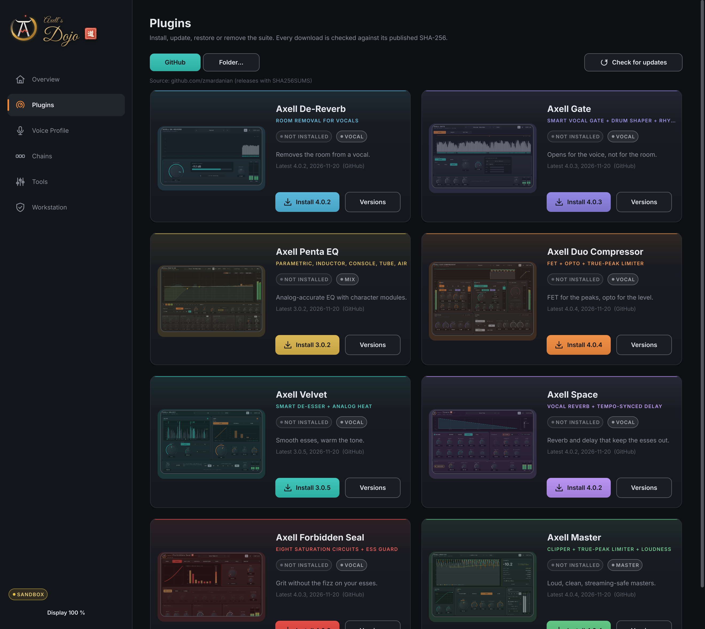
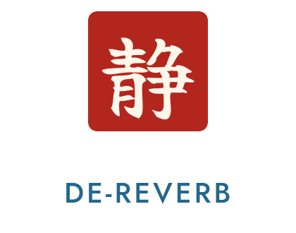
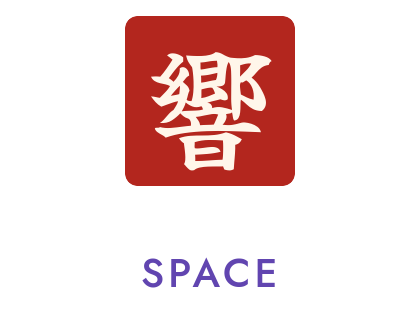
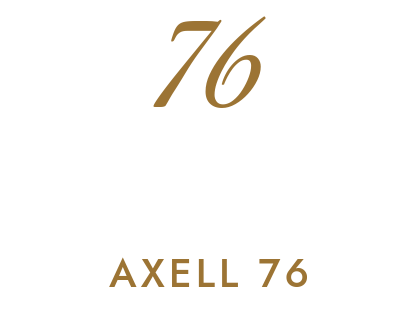
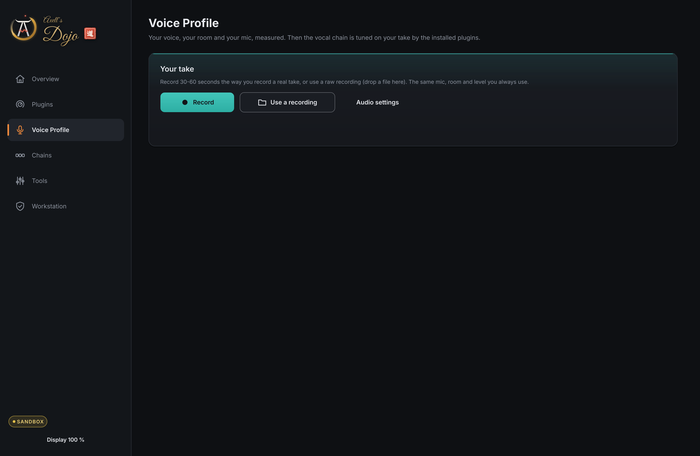
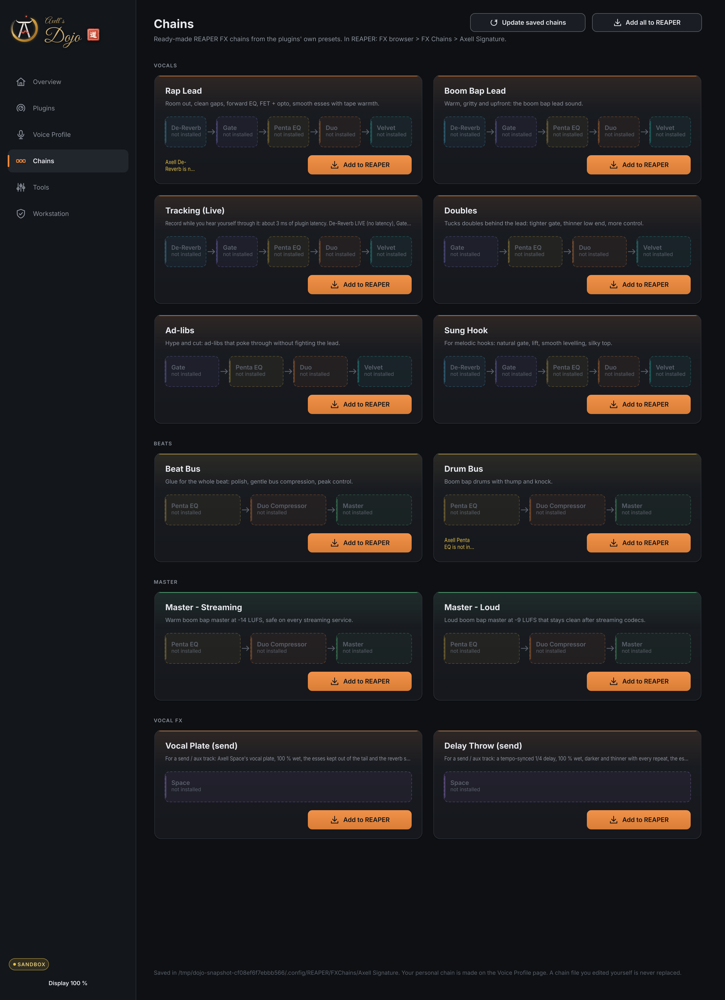
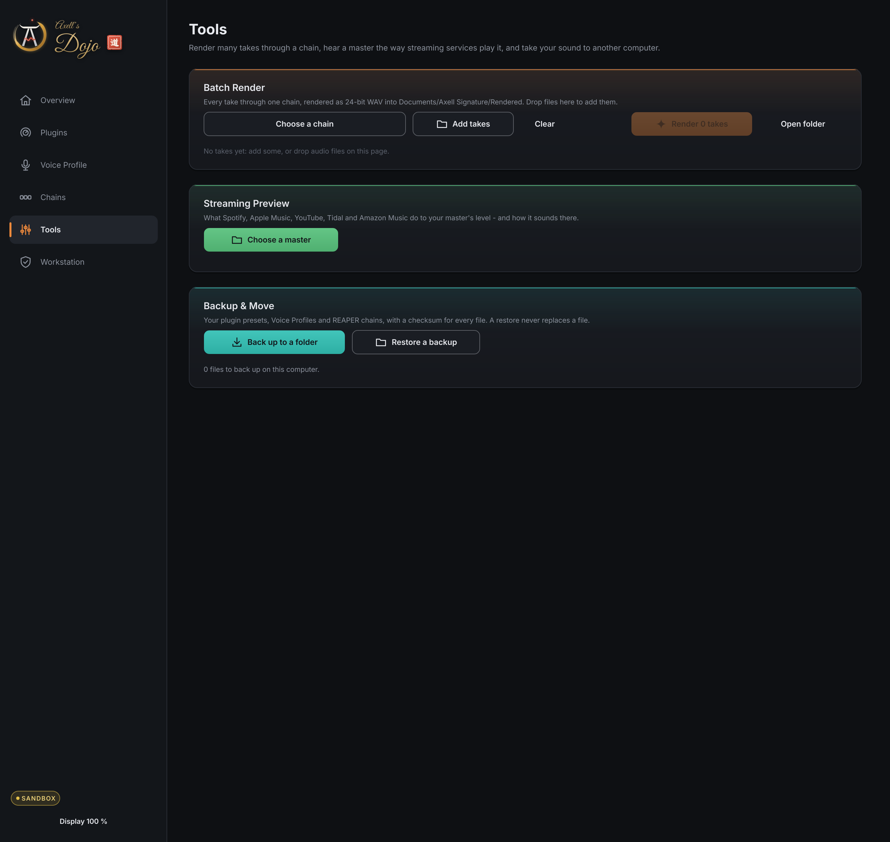
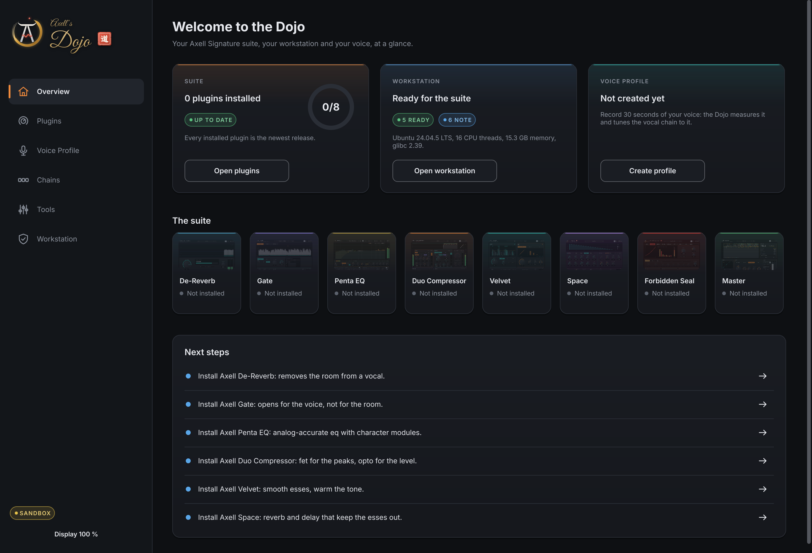

<p align="center">
<picture>
  <source media="(prefers-color-scheme: dark)" srcset="docs/img/type/hero-dark.png">
  
</picture>
</p>

<p align="center">
  <a href="https://github.com/zmardanian/axell-signature-dojo/releases/latest"></a>
  <a href="https://github.com/zmardanian/axell-signature-dojo/releases"></a>
  
  <a href="https://github.com/zmardanian/axell-signature-dojo/actions/workflows/ci.yml"></a>
  
  <a href="https://ko-fi.com/axellyobag"></a>
</p>

<p align="center">
  
</p>

<p align="center">
  <b>Your whole vocal chain, tuned to your voice from one dry take.</b><br>
  The home of the Axell Signature suite: it installs and updates every plugin, measures your voice and your room, tunes a complete chain by rendering your take through the plugins, and opens it in REAPER - on Windows and Linux.
</p>

<p align="center">
  <a href="https://github.com/zmardanian/axell-signature-dojo/releases/latest"><picture>
  <source media="(prefers-color-scheme: dark)" srcset="docs/img/type/dl-windows-dark.png">
  
</picture></a>
  &nbsp;&nbsp;
  <a href="https://github.com/zmardanian/axell-signature-dojo/releases/latest"><picture>
  <source media="(prefers-color-scheme: dark)" srcset="docs/img/type/dl-linux-dark.png">
  
</picture></a>
</p>

<p align="center"><sub>Free and open source (AGPL-3.0)  ·  Windows 10 / 11 and Linux  ·  the Dojo and every plugin, one installer</sub></p>

<p align="center"><a href="https://ko-fi.com/axellyobag"></a></p>

<br>

<picture>
  <source media="(prefers-color-scheme: dark)" srcset="docs/img/type/h-why-dark.png">
  
</picture>

- **One installer on Windows** - the Dojo and all nine plugins, each one optional - every VST3 host loads them.
- **A chain tuned to you** - Voice Profile measures loudness, noise, pitch, your esses, the room and the low end, then tunes the chain on your take.
- **Your signature, one click** - from a dry take to a REAPER session through your approved vocal and master chains.
- **Safe updates** - every archive checked against its published SHA-256; the previous version kept as a backup.
- **Hear it like your listeners** - Streaming Preview: what Spotify, Apple Music, YouTube, Tidal and Amazon Music do to your master.

<br>

<picture>
  <source media="(prefers-color-scheme: dark)" srcset="docs/img/type/h-suite-dark.png">
  
</picture>

<p align="center">
<table>
<tr><td align="center"><a href="https://github.com/zmardanian/axell-penta-eq"><picture>
  <source media="(prefers-color-scheme: dark)" srcset="docs/img/suite/penta-eq-dark.png">
  
</picture></a><br><sub>analog-matched EQ</sub></td><td align="center"><a href="https://github.com/zmardanian/axell-duo-compressor"><picture>
  <source media="(prefers-color-scheme: dark)" srcset="docs/img/suite/duo-compressor-dark.png">
  
</picture></a><br><sub>FET + opto + limiter</sub></td><td align="center"><a href="https://github.com/zmardanian/axell-gate"><picture>
  <source media="(prefers-color-scheme: dark)" srcset="docs/img/suite/gate-dark.png">
  
</picture></a><br><sub>voice-aware gate</sub></td><td align="center"><a href="https://github.com/zmardanian/axell-dereverb"><picture>
  <source media="(prefers-color-scheme: dark)" srcset="docs/img/suite/dereverb-dark.png">
  
</picture></a><br><sub>small-room de-reverb</sub></td><td align="center"><a href="https://github.com/zmardanian/axell-velvet"><picture>
  <source media="(prefers-color-scheme: dark)" srcset="docs/img/suite/velvet-dark.png">
  
</picture></a><br><sub>neural de-esser + warmth</sub></td></tr>
<tr><td align="center"><a href="https://github.com/zmardanian/axell-master"><picture>
  <source media="(prefers-color-scheme: dark)" srcset="docs/img/suite/master-dark.png">
  
</picture></a><br><sub>mastering limiter</sub></td><td align="center"><a href="https://github.com/zmardanian/axell-space"><picture>
  <source media="(prefers-color-scheme: dark)" srcset="docs/img/suite/space-dark.png">
  
</picture></a><br><sub>vocal reverb + delay</sub></td><td align="center"><a href="https://github.com/zmardanian/axell-forbidden-seal"><picture>
  <source media="(prefers-color-scheme: dark)" srcset="docs/img/suite/forbidden-seal-dark.png">
  
</picture></a><br><sub>saturation</sub></td><td align="center"><a href="https://github.com/zmardanian/axell-76"><picture>
  <source media="(prefers-color-scheme: dark)" srcset="docs/img/suite/76-dark.png">
  
</picture></a><br><sub>1176 FET compressor</sub></td><td align="center"><a href="https://github.com/zmardanian/axell-signature-dojo"><picture>
  <source media="(prefers-color-scheme: dark)" srcset="docs/img/suite/signature-dojo-dark.png">
  
</picture></a><br><sub>the suite's home</sub></td></tr>
</table>
</p>

Nine plugins and their home, built as one family: they share a core library, so a breakthrough in one becomes a feature of the next - the sibilance network of Velvet guards the esses in Duo, Master, Space and Forbidden Seal; Gate's voice detector holds Duo's and Master's gain through your pauses. The [Axell Signature Dojo](https://github.com/zmardanian/axell-signature-dojo) installs, updates and tunes the whole suite to your voice - on Windows from a single installer.

| Plugin | What it is | Latest |
|---|---|---|
| [Axell De-Reverb](https://github.com/zmardanian/axell-dereverb) 4.0.1 | removes the room from a close vocal (a trained network), LIVE mode for recording | **TRUE TONE**: gives back the low end room removal takes too much of |
| [Axell Gate](https://github.com/zmardanian/axell-gate) 4.0.1 | a gate that hears the voice and the room, removes headphone bleed, shapes drums | **PITCH HOLD**: soft syllables stay open in the zero-latency gate |
| [Axell Penta EQ](https://github.com/zmardanian/axell-penta-eq) 3.0.1 | analog-matched parametric, dynamic and spectral EQ with a character rack | **Ess** detector source (Velvet's sibilance network) |
| [Axell Duo Compressor](https://github.com/zmardanian/axell-duo-compressor) 4.0.3 | FET + opto compressor and true-peak limiter | **ESS HOLD**: the gain holds through your esses (no lifted esses) |
| [Axell Velvet](https://github.com/zmardanian/axell-velvet) 3.0.4 | neural de-esser + tape / console / tube warmth | the zero-latency LIVE de-esser |
| [Axell Master](https://github.com/zmardanian/axell-master) 4.0.3 | clipper, true-peak limiter, loudness, streaming-codec check | **ESS HOLD** for a vocal bus; 4.0.3: the same sound with 16 % less CPU (22 % on Windows) |
| [Axell Space](https://github.com/zmardanian/axell-space) 4.0.1 | 32-line true-stereo vocal reverb + CLEAN / TAPE / ANALOG delay, zero latency | **REAL SPACES**: eight real rooms modelled from size and wall materials; **UNMASK** steps the effects back only where they cover the voice |
| [Axell Forbidden Seal](https://github.com/zmardanian/axell-forbidden-seal) 4.0.2 | saturation: eight circuits from physics, three bands, ESS GUARD, LEARN | **Decoupled saturation**: the voice never passes a circuit - only the harmonics are added, placed out of the box (**FOCUS**, **VOICING**) |
| [Axell 76](https://github.com/zmardanian/axell-76) 3.2.0 | a clean-room 1176 FET compressor anchored to a real 1176LN | all five ratios incl. all-buttons; in the Windows suite installer |

<br>

<picture>
  <source media="(prefers-color-scheme: dark)" srcset="docs/img/type/h-does-dark.png">
  
</picture>

**Axell's Dojo** - the home of the Axell Signature suite on Linux and Windows: it installs and updates the eight plugins, tunes a
complete vocal chain to *your* voice from one dry take, and sets up REAPER and your workstation. On Windows one installer
carries the Dojo and all nine plugins, Axell 76 included.

- **Plugins**: install, update, reinstall, restore earlier versions or remove - from GitHub or a folder (USB stick).
  Every archive is checked against its published SHA-256 and unpacked by a strict reader; only the plugin bundle is
  installed, and the previous version is kept as a backup.
- **Voice Profile**: record or drop a dry take. The Dojo measures loudness, background noise, pitch, where your
  esses sit, the room's decay and the low end, plans the vocal chain, then tunes it by rendering your take through
  the installed plugins (compression amounts, Velvet's LEARN level, loudness matched at every stage). It saves
  presets for Gate, Penta EQ, Duo Compressor and Velvet plus a REAPER FX chain for mixing and a tracking chain for
  recording (De-Reverb's LIVE mode and Velvet's zero-latency de-esser, about 3 ms in all) - never replacing your own files. Velvet's de-esser amount is
  set on your take: your esses end up where natural speech has them (111 voices).
- **Open in REAPER**: a new REAPER project with an armed vocal track holding your chain, in one click.
- **Step-through listening, Reference Match and confidence**: hear your take after each plugin; move your tone toward
  a reference vocal (measured on the rendered take); every measurement says how far to trust it.
- **Signature sound** (3.1): your approved vocal + master chains, one click from a dry take to a REAPER session -
  the take matched to the level the chains were tuned on, the master at -14 or -11 LUFS.
- **Chains**: twelve ready-made REAPER FX chains (vocals, vocal FX sends, beats, master, tracking) from the plugins'
  factory presets; **Update saved chains** brings chains saved with older plugin versions up to the installed ones,
  keeping every value you set.
- **Tools**: Batch Render (many takes through one chain), Streaming Preview (what Spotify, Apple Music, YouTube,
  Tidal and Amazon Music do to your master, and how it sounds there), Backup & Move (checksum-verified, never
  overwriting).
- **Workstation**: system, plugin folder, DAWs (native and Flatpak), REAPER's plugin path and scan, PipeWire buffer,
  realtime priority, system effects. Checks only read; fixes run in your account after you confirm.
- **UAD bridge** (3.2, only where Universal Audio's UADx plugins run through the UADX toolkit): one Wine for the UAD
  prefix, the bridge set-up, the plugins' test results, the rollback point, REAPER opened the UAD way - with Give it
  back, Re-link, Full diagnosis, Test all again, Snapshot now and Open REAPER.

Terminal: `--check` (workstation report), `--profile <take> [--reference <vocal>] [--name N] [--reduction %] [--gate-range dB] [--save [--open]]`,
`--render <chain.RfxChain> <out folder> <take>...` (Batch Render), `--signature <name> --take <file> --target <LUFS> [--open]`,
`--update-chains [chain.RfxChain...]`. `AXELL_DOJO_SANDBOX=<dir>` keeps
every file the Dojo touches inside `<dir>`.

<table>
<tr><td align="center" width="50%"><br><sub>Voice Profile</sub></td><td align="center" width="50%"><br><sub>Chains</sub></td></tr>
<tr><td align="center" width="50%"><br><sub>Tools</sub></td><td align="center" width="50%"><br><sub>Overview</sub></td></tr>
</table>

<br>

<picture>
  <source media="(prefers-color-scheme: dark)" srcset="docs/img/type/h-install-dark.png">
  
</picture>

**Windows 10 / 11 (64-bit):** download `AxellSignatureSuite-3.3.2-windows-x64-setup.exe` from the
[latest release](https://github.com/zmardanian/axell-signature-dojo/releases/latest) and run it: the Dojo, the
eight plugins and [Axell 76](https://github.com/zmardanian/axell-76) (VST3, in `C:\Program Files\Common Files\VST3`),
each one optional; every VST3 host loads them (REAPER, Ableton Live, FL Studio, Cubase, Studio One, Bitwig...). The installer is not code-signed
yet, so Windows SmartScreen may say "Windows protected your PC": choose **More info > Run anyway**. Later updates come
from the Dojo's Plugins page. UAD support is Linux only (on Windows, Universal Audio's own software runs UADx).

**Linux:** download `AxellSignatureDojo-3.3.2-linux-x86_64.tar.gz` from the same release (optional:
`sha256sum -c SHA256SUMS.txt`), extract it and run `./install.sh`; open "Axell Signature Dojo" from your app menu.
Linux x86_64, glibc 2.39+. From there the Plugins page installs the suite (from GitHub or a folder, e.g. a USB stick).

<br>

<picture>
  <source media="(prefers-color-scheme: dark)" srcset="docs/img/type/h-history-dark.png">
  
</picture>

| Version | Engineering | Measured |
|---|---|---|
| **1.0.0** | Plugins page (checksum-verified install, update, backup, restore), Voice Profile, nine REAPER chain templates, Workstation checks | - |
| **2.0.0** | Open in REAPER, step-through listening, Reference Match, a confidence for every measurement, Batch Render, Streaming Preview, Backup & Move; an outside code review's findings fixed (atomic swap, strict archive reader) | sandboxed platform tests, ASan/UBSan clean, REAPER loads every chain 12/12 |
| **2.0.1** | Small noisy rooms get De-Reverb Clean (95 %); Batch Render on the terminal | 95-100 % measured best on home recordings (DESIGN D21) |
| **2.1.0** | The Voice Profile listens with Velvet 3.0's detector (111 voices); Velvet's AMOUNT tuned on your take to where natural speech has its esses; a tracking chain for recording | the artist's take: esses' loud end -1.9 -> -10.4 dB at the tuned 50 %; tracking chain 3.4 ms (Gate BEST would be 70 ms) |
| **3.0.0** | The suite at 3.0, connected: the tracking chain includes De-Reverb LIVE (0 ms); profiles tuned on the 3.0 plugins (Duo's VOICE HOLD, Gate 3.0, Master's VOICE HOLD); Axell's Dojo brush title | tracking chain 5 plugins, 3.4 ms; core 64/64, platform 149/149, REAPER 14/14 |
| **3.0.1** | New app icon: the Dojo's 道 hanko seal on washi inside a gold ensō, installed in every size | legible down to 32 px; no cached older icon left behind |
| **3.0.2** | The seal icon redrawn as a calligraphy page: sumi-ink ensō on washi with the 道 seal, evenly lit | clear on dark desktops (3.0.1's tile was dark at the edges) |
| **3.1.0** | Signature sounds (approved chains one click from a take: level-matched, master at -14 / -11 LUFS); Update saved chains; Axell Space and its send chains | 3 other takes land at -14.0 +-0.05 LUFS; updated Amber chain on 28 takes: UTMOS 2.267 -> 2.279, esses -0.5 dB; core 64/64, platform 175/175, ASan/UBSan clean, REAPER 17/17 |
| **3.2.0** | UAD bridge on the Workstation page: read-only checks of the UAD Wine, bridge, plugin tests and rollback point, with confirmed fixes (repair, re-link, test, snapshot, open REAPER detached) | the artist's machine: a second Wine version found running the UAD prefix and fixed; 11 of 13 UADx plugins pass the bridge test; shared Wine process 2.1 -> 0.67 GB for six plugins; core 64/64, platform 189/189, ASan/UBSan clean, REAPER 17/17 |
| **3.3.0** | Windows: the Dojo and the eight plugins (one installer); install, update and restore with an administrator restart; Windows workstation checks (VST3 folder, REAPER, ASIO, power plan); UAD stays Linux only | every plugin built and tested on Windows by CI, renders matching Linux (five bit-identical, the rest within -130.5 dBFS); Windows core 59/59, platform 113/113; Linux core 64/64, platform 189/189, ASan/UBSan clean, REAPER 17/17 |
| **3.3.1** | Linux: a rare crash when closing a hosted plugin fixed (a JUCE hosting bug, fixed at build time in the Axell core) | pluginval with the same fix 40/40 clean (stock 3/40 crashed); core 64/64, platform 189/189, REAPER 17/17 |
| **3.3.2** | The suite installer carries this round's optimised plugins (the same sound, less CPU: Master 4.0.3, Forbidden Seal 4.0.2, Gate 4.0.1, Space 4.0.1, Velvet 3.0.4, Duo Compressor 4.0.3, De-Reverb 4.0.1); the Dojo on the faster shared core | every plugin byte-identical to its previous release (presets + random settings); core 64/64, platform 189/189, REAPER 17/17 |

The reasoning behind every rule, with its measurement: [docs/DESIGN.md](docs/DESIGN.md); all changes: [CHANGELOG.md](CHANGELOG.md).

<br>

<picture>
  <source media="(prefers-color-scheme: dark)" srcset="docs/img/type/h-build-dark.png">
  
</picture>

```
scripts/build.sh
scripts/install.sh
```
Tests: `build/DojoCoreTests`, `build/DojoPlatformTests_artefacts/Release/DojoPlatformTests` (sandboxed), and
`tools/reaper-verify.sh` (loads every chain in a portable REAPER copy).

<br>

<picture>
  <source media="(prefers-color-scheme: dark)" srcset="docs/img/type/h-credits-dark.png">
  
</picture>

**Free forever, kept alive by you.** The Dojo costs nothing and never will - no subscriptions, no licence keys. If it has earned a place in your mixes, you can [support the Dojo on Ko-fi](https://ko-fi.com/axellyobag) - one-time or monthly, from €3.


AGPLv3 (JUCE is used under AGPLv3). Third-party: JUCE 8.0.15 (AGPLv3), Inter and Yuji Syuku fonts (SIL OFL 1.1),
axell-core (vendored in `external/axell-core`).
The low-mid reference curve is derived from the VCTK corpus (CC BY 4.0, University of Edinburgh) and CMU ARCTIC.
Contact: contact@axellsdojo.com

<br>

<sub>VST is a registered trademark of Steinberg Media Technologies GmbH. 1176, 1176LN, LA-2A, UADx and Universal Audio are trademarks of their respective owners. The Axell plugins are independent works, not affiliated with or endorsed by them; the names only describe what was measured and compared.</sub>
